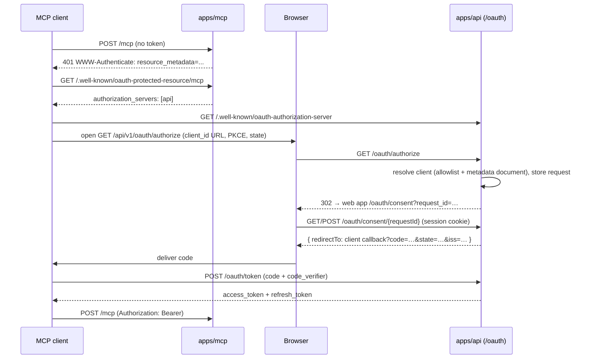

# oauth

The OAuth 2.1 authorization server MCP clients connect through. `apps/mcp` is the protected
resource; this app is the only thing that issues or validates a credential.

## Why a client never registers

A `client_id` here is always an https URL that serves a **Client ID Metadata Document**
(draft-ietf-oauth-client-id-metadata-document). There is no dynamic client registration endpoint and
no first-party client table: a client publishes what it would otherwise have POSTed, at a URL only
its owner controls, and this server fetches it. `GET /.well-known/oauth-authorization-server`
advertises `client_id_metadata_document_supported` so a client knows registration is neither needed
nor offered.

Publishing a document is a claim anyone can make, so it is not by itself admission.
`MCP_OAUTH_ALLOWED_CLIENT_DOMAINS` is the admission policy: the document's host must appear in that
list, compared **exactly** and case-insensitively. A suffix match would hand `evil-claude.ai` the
trust an operator meant for `claude.ai`, and a subdomain is a different party, so both must be
listed in their own right. The allowlist is checked before anything is fetched, which is also what
keeps the fetch from being a server-side request forgery primitive.

The document itself is then held to the same rules a registration request would be, plus the one
that matters most: its `client_id` must equal the URL it was served from. Redirects are refused,
since a redirect would break that equality and could move the fetch off the allowlisted host. The
result is cached until the origin's `Cache-Control` says otherwise, clamped between five minutes and
a day; a document that later stops resolving falls back to the last good copy rather than retracting
consent the user has already given.

## Where a failure goes

`redirect_uri` is where an error response would be sent, so until the client is resolved **and** the
URI proven to be one it published, an error redirect would be an open redirect carrying this
server's name. Those failures render on the web app's `/oauth/error` page instead. Everything after
that point — a bad `response_type`, a missing `code_challenge`, a denial — redirects back to the
client the way RFC 6749 §4.1.2.1 requires.

## Scopes

One scope, `mcp`. An MCP client that can read a workout can also log a set, and a split this server
did not actually enforce at the tool surface would claim a boundary that is not there. The consent
screen spells out what the single scope grants.

## Tokens

Opaque and stored as sha256 hashes, never JWTs. `apps/mcp` holds no database connection and no
signing key, so it forwards whatever it was given to this app, which is the only process that can
decide what a credential means — and an opaque token stops working the instant a user disconnects
the app, which a self-contained JWT could not.

Both single-use credentials detect replay the same way: the redeemed row is marked consumed rather
than deleted, and presenting a consumed one revokes the whole grant (RFC 6749 §4.1.2,
RFC 9700 §4.14.2). A leaked credential therefore costs the attacker the connection rather than
buying them one.

A grant is pinned to one workspace, resolved at consent time from the user's own workspace.
Workspaces are an internal concept in Phase 1, so consent never asks about one.

## Flow

