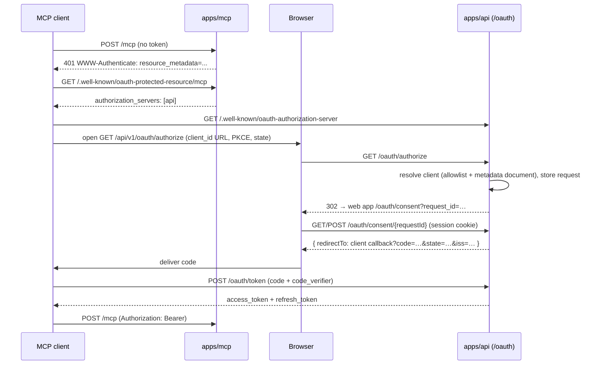

# oauth

The OAuth 2.1 authorization server MCP clients connect through. `apps/mcp` is the protected
resource; this app is the only thing that issues or validates a credential.

## Why a client never registers

A `client_id` here is always an https URL that serves a **Client ID Metadata Document**
(draft-ietf-oauth-client-id-metadata-document). There is no dynamic client registration endpoint and
no first-party client table: a client publishes what it would otherwise have POSTed, at a URL only
its owner controls, and this server fetches it. `GET /.well-known/oauth-authorization-server`
advertises `client_id_metadata_document_supported` so a client knows registration is neither needed
nor offered.

The document is held to the same rules a registration request would be, plus the one that matters
most: its `client_id` must equal the URL it was served from. Redirects are refused, since a redirect
would break that equality. The result is cached until the origin's `Cache-Control` says otherwise,
clamped between five minutes and a day; a document that later stops resolving falls back to the last
good copy rather than retracting consent the user has already given.

## Verified and unverified clients

Any client that gets that far may authorize. Publishing a document is a claim anyone can make, and
refusing every unknown client would make this server usable only by clients an operator had heard
of.

`MCP_OAUTH_VERIFIED_CLIENT_IDS` changes what the user is told, not who gets in. A client outside it
still reaches the consent screen — carrying an unverified warning and the hosts approving would send
them to — and the Connected Apps list marks it the same way. Verification is evaluated per read, so
editing the list takes effect without waiting for cached documents to expire.

Entries are whole `client_id` URLs, or a directory prefix ending in `/`. Never a bare host: a host
serves documents written by whoever can publish there. `claude.ai` serves both Claude's own metadata
document and every Artifact its users publish, so trusting the host would vouch for anything anyone
put at `https://claude.ai/public/artifacts/…`. The trailing slash on a prefix is required, or
`…/clients` would also vouch for `…/clientsevil`.

## The metadata fetch is an SSRF surface

The URL being dereferenced arrives from an unauthenticated caller, so the request goes through
`createSafeFetch` from `@app/ssrf`: https only, no redirects, every resolved address must be public
unicast, and those addresses are pinned onto the connection so a second lookup cannot rebind. That
package's README has the detail, including why it has no way to turn the check off.

What this module adds on top is the response budget: a five-second timeout, a `content-type` of
`application/json`, and a 64 KiB cap enforced **while streaming**, because `content-length` is a
claim and a server that omits it must not be able to make this process buffer an endless body.

## Where a failure goes

`redirect_uri` is where an error response would be sent, so until the client is resolved **and** the
URI proven to be one it published, an error redirect would be an open redirect carrying this
server's name. Those failures — a `client_id` that is not a metadata document URL, a document that
cannot be read, an unregistered `redirect_uri` — render on the web app's `/oauth/error` page
instead. Everything after that point — a bad `response_type`, a missing `code_challenge`, a denial —
redirects back to the client the way RFC 6749 §4.1.2.1 requires.

## Scopes

One scope, `mcp`. An MCP client that can read a workout can also log a set, and a split this server
did not actually enforce at the tool surface would claim a boundary that is not there. The consent
screen spells out what the single scope grants.

## Tokens

Opaque and stored as sha256 hashes, never JWTs. `apps/mcp` holds no database connection and no
signing key, so it forwards whatever it was given to this app, which is the only process that can
decide what a credential means — and an opaque token stops working the instant a user disconnects
the app, which a self-contained JWT could not.

Both single-use credentials detect replay the same way: the redeemed row is marked consumed rather
than deleted, and presenting a consumed one revokes the whole grant (RFC 6749 §4.1.2,
RFC 9700 §4.14.2). A leaked credential therefore costs the attacker the connection rather than
buying them one.

A grant is pinned to one workspace, resolved at consent time from the user's own workspace.
Workspaces are an internal concept in Phase 1, so consent never asks about one.

## Flow



## Running the flow locally

The client (Claude, Cursor) and the user's browser both have to reach this server, so `localhost`
alone is not enough. Two public HTTPS tunnels — `ngrok`, `cloudflared`, whichever — one at
`apps/api` and one at `apps/mcp`:

```bash
cloudflared tunnel --url http://localhost:3000   # apps/api
cloudflared tunnel --url http://localhost:3100   # apps/mcp
```

Then point the configuration at those origins, because every URL in a discovery document is built
from them rather than from the request:

| Variable                                                  | Value                   |
| --------------------------------------------------------- | ----------------------- |
| `API_BASE_URL`, `AUTH_BASE_URL` (`apps/api`)              | the api tunnel          |
| `MCP_BASE_URL` (both apps)                                | the mcp tunnel          |
| `API_INTERNAL_BASE_URL` (`apps/mcp`)                      | `http://localhost:3000` |
| `WEB_APP_BASE_URL`, `CORS_ORIGIN`, `AUTH_TRUSTED_ORIGINS` | the web dev server      |

Add the mcp tunnel's `/mcp` URL in the client and it will discover the rest. The client's own
metadata document is fetched outbound from wherever the client publishes it, so it needs no tunnel.

To check discovery without a real client:

```bash
curl -fsS https://<mcp-tunnel>/.well-known/oauth-protected-resource
curl -fsS https://<api-tunnel>/.well-known/oauth-authorization-server
curl -si  https://<mcp-tunnel>/mcp -X POST | grep -i www-authenticate
```

The MCP Inspector (`npx @modelcontextprotocol/inspector`) drives the whole flow, including consent,
against those URLs. Its `client_id` has to be a metadata document this server can actually reach, so
serve the test client's document from somewhere public — a gist's raw URL, GitHub Pages, or a third
tunnel — rather than from `localhost`. `@app/ssrf` refuses a private address and offers no way
around it, deliberately.
